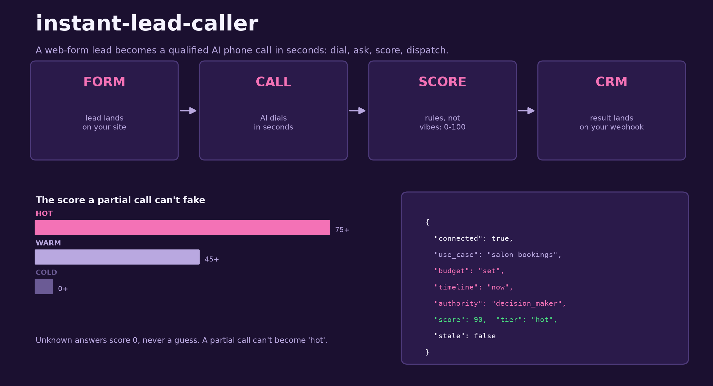

# instant-lead-caller

Turn a web-form lead into a qualified AI phone call in seconds.



A website form is a promise nobody keeps. By the time someone reads the
submission, the lead is cold. This tool flips the order: the moment a lead
arrives, it places an AI call, asks four qualification questions, scores the
answers with deterministic rules, and pushes the result to your CRM webhook.

## Why rules, not vibes

An LLM can write a lovely summary of a call. It cannot be relied on to say the
same number twice. The scoring here is plain arithmetic over three signals:

- **budget**: set / flexible / none
- **timeline**: now / this quarter / exploring
- **authority**: decision maker / influencer / unknown

Unknowns score zero instead of guessing, so a partial call never inflates a
lead into "hot". Tests assert on the exact numbers.

## Quickstart

```bash
# stdlib only, nothing to install
python -m lead_caller --demo
```

The demo runs the full pipeline on a scripted caller: dial, ask, score,
print the payload. Add `--webhook https://your-crm.example/leads` to POST
the same payload to a real endpoint.

## The stale-lead rule

A lead called within 30 seconds is still thinking about your service. The
flow marks anything older as `stale: true` instead of pretending it is
fresh, so downstream automation can treat it differently.

## Status

Early. The seams are the point: `TelephonyAdapter` and `CRMWebhook` are the
only two things to swap for a real provider. Roadmap: a Twilio adapter,
LLM-driven question branching, and retry windows for no-answer calls.

MIT licensed. Built in public by [Dial AI Agent](https://dialaiagent.com).
